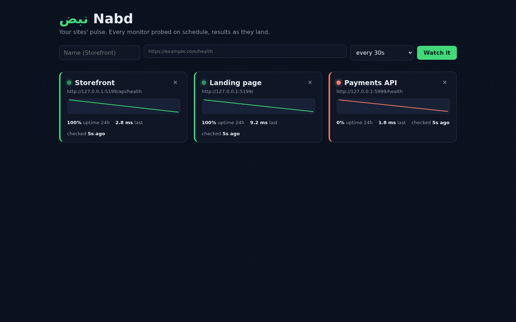
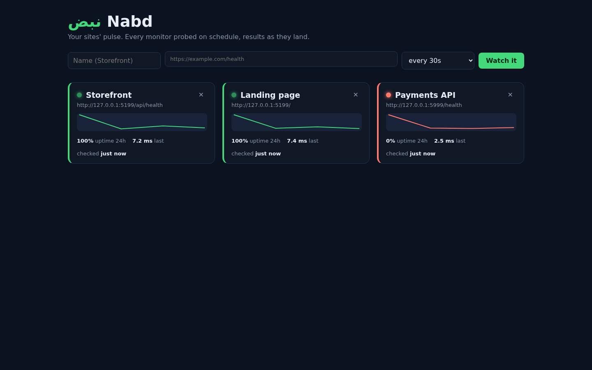

# Nabd نبض

Your sites' pulse. A self-hosted uptime monitor: point it at your endpoints
and it probes each one on its own schedule, records every result, and shows
live status, 24-hour uptime, and latency sparklines on a dashboard that
updates itself. ASP.NET Core 8, EF Core + SQLite, React - one process, one
file of state, zero external services.

## What it looks like

Three monitors, one down - every frame of this GIF is a real probe landing:





## Run it

```bash
dotnet run --project src/Nabd.Server
# open http://localhost:5199 and add your first endpoint
```

Frontend dev loop: `npm run dev` in `web/` (proxies `/api`).
`npm run build` writes into the server's wwwroot; the published app serves
the dashboard itself.

## How it works

- **The checker is a one-second heartbeat.** Each round it picks monitors
  whose `NextCheckAt` has passed and probes them in parallel. Probes are
  rescheduled from their *start* time, so a slow target can't drift its own
  cadence.
- **A probe is honest about outcomes.** Matching the expected status is up;
  any other status is down with the code recorded; no answer at all is down
  with no code - the dashboard can tell "500" from "unreachable" from
  "timeout".
- **Results are data, not log lines.** Every probe writes one `CheckResult`
  row (SQLite); uptime %, sparklines and "last checked" are all read models
  over the last 24 hours of rows.
- **The dashboard polls every 5 seconds** and renders what the API says.
  Nothing optimistic, nothing cached client-side.

## API

```
GET    /api/monitors              list with status, uptime24h, latency, sparkline
POST   /api/monitors              { name, url, intervalSeconds }  (5s..1h)
DELETE /api/monitors/{id}         stop watching, drop history
GET    /api/monitors/{id}/results recent probe results
```

## Tests

```bash
dotnet test   # 10 tests
```

Probe behavior is tested against stub HTTP transports (matching status,
wrong status, unreachable), the scheduler against its due/reschedule rules,
and the whole stack - hosted checker included - through
WebApplicationFactory with a fake probe: a monitor that comes up, a monitor
that stays down, and the CRUD + validation surface.

## Limits (it's v1)

Single node, no auth (it's meant to sit behind your network or a reverse
proxy), no alert channels yet - the dashboard is the alarm for now. History
grows unbounded; retention pruning is the obvious next step. Intervals under
5 seconds are clamped away on purpose: be polite to your own servers.
